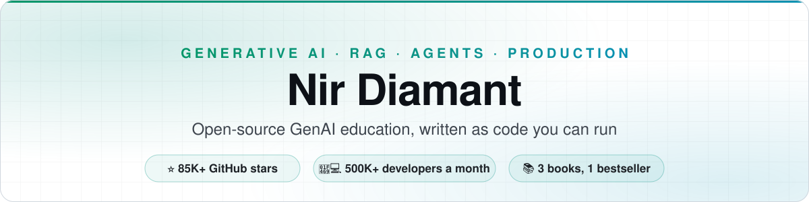

<!-- launch-banner-099: remove when the $0.99 launch price ends -->

**_AI Agents Made Simple_ reached #1 in Software Development, Software Engineering and Software Design Tools on Amazon.com's Kindle Store.** 
A decision guide to building AI agents that work: 28 chapters, 148 illustrations, no code. 
**[Get the book on Amazon →](https://europe-west1-rag-techniques-views-tracker.cloudfunctions.net/rag-techniques-tracker?notebook=github-profile-readme&click=launch-banner-099&target=https%3A%2F%2Fwww.amazon.com%2Fdp%2FB0HNXRSRH2&retarget=0&text=launch-banner-099)**

<!-- /launch-banner-099 -->

<a href="https://github.com/NirDiamant">
<picture>
  <source media="(prefers-color-scheme: dark)" srcset="assets/banner-dark.svg">
  
</picture>
</a>

 

I turn AI research into systems that hold up in production, and I teach it the same way: **runnable notebooks, not slide decks.** 
Six open-source repos, four books, and a weekly newsletter. Everything here is free to read and run.

 

  

**Start here:** &nbsp;
[Learn for free](#-open-source-learn-by-running-the-code) &nbsp;·&nbsp;
[Read the books](#-books-the-super-ai-engineering-series) &nbsp;·&nbsp;
[Get the newsletter](#-newsletter-and-community) &nbsp;·&nbsp;
[Work with me](#-work-with-me)

 

## 📂 Open source: learn by running the code

Every repository is a curriculum. Each technique is a self-contained notebook you can open, run and adapt, with the intuition explained next to the code.

| Repository | What you will learn | Stars |
| :--- | :--- | :---: |
| **[RAG Techniques](https://github.com/NirDiamant/RAG_Techniques)** | 42 notebooks on retrieval-augmented generation, from chunking and reranking to agentic, graph-based and self-correcting RAG, plus an evaluation suite. |  |
| **[GenAI Agents](https://github.com/NirDiamant/GenAI_Agents)** | 64 agent implementations, from a single conversational bot to multi-agent and self-improving systems, across LangGraph, AutoGen and PydanticAI. |  |
| **[Agents Towards Production](https://github.com/NirDiamant/agents-towards-production)** | The playbook for shipping agents: orchestration, memory, security, observability, evaluation, deployment, GPU serving and fine-tuning. |  |
| **[Prompt Engineering](https://github.com/NirDiamant/Prompt_Engineering)** | 22 prompting techniques, from basic structure through chain-of-thought, self-consistency, prompt security and systematic evaluation. |  |
| **[Controllable RAG Agent](https://github.com/NirDiamant/Controllable-RAG-Agent)** | One complete reference agent: a deterministic graph that plans, decomposes questions, retrieves across stores and verifies its own groundedness. |  |
| **[Agent Memory Techniques](https://github.com/NirDiamant/Agent_Memory_Techniques)** | 30 notebooks on memory for agents: buffers, vector and graph stores, cognitive architectures, Mem0, Letta, Zep, Graphiti and LoCoMo benchmarks. |  |

**Smaller tools:** [claude-watch](https://github.com/NirDiamant/claude-watch) (live observability for Claude Code sessions) · [Agentic Engineering](https://github.com/NirDiamant/Agentic_Engineering) (a docs layer that gives your coding agent a memory of your project) · [moltbook-agent-guard](https://github.com/NirDiamant/moltbook-agent-guard) (prompt-injection scanning and guardrails for agents)

 

## 📚 Books: the Super AI Engineering series

Visual, intuition-first guides, with diagrams that make the tricky parts click. All four are on Amazon.

- **[RAG Made Simple](https://europe-west1-rag-techniques-views-tracker.cloudfunctions.net/rag-techniques-tracker?notebook=github-profile-readme&click=book-card-rag-cta&target=https%3A%2F%2Fwww.amazon.com%2Fdp%2FB0GWDH8JJL&retarget=0&text=book-card-rag-cta)** - 400 pages, 22 techniques, with side-by-side comparisons and diagrams. 🏆 Amazon bestseller in Generative AI.
- **[Agent Memory Made Simple](https://europe-west1-rag-techniques-views-tracker.cloudfunctions.net/rag-techniques-tracker?notebook=github-profile-readme&click=book-card-am-cta&target=https%3A%2F%2Fwww.amazon.com%2Fdp%2FB0HCRMGHCM&retarget=0&text=book-card-am-cta)** - 467 pages on how agents remember: buffers, vector and graph memory, cognitive architectures and the frameworks in production.
- **[Prompt Engineering: Master the Art of AI Interaction](https://europe-west1-rag-techniques-views-tracker.cloudfunctions.net/rag-techniques-tracker?notebook=github-profile-readme&click=book-card-pe-cta&target=https%3A%2F%2Fwww.amazon.com%2Fdp%2FB0DZ85RPB5&retarget=0&text=book-card-pe-cta)** - 22 chapters of hands-on prompting techniques, the foundation that makes RAG and agents work better.
- **[AI Agents Made Simple](https://europe-west1-rag-techniques-views-tracker.cloudfunctions.net/rag-techniques-tracker?notebook=github-profile-readme&click=book-card-agents-cta&target=https%3A%2F%2Fwww.amazon.com%2Fdp%2FB0HNXRSRH2&retarget=0&text=book-card-agents-cta)** - the decision guide to building agents that work: 28 chapters on what each pattern does, what breaks, what it costs, and when it is overkill. No code.

 

## 💌 Newsletter and community

- **[DiamantAI Newsletter](https://europe-west1-rag-techniques-views-tracker.cloudfunctions.net/rag-techniques-tracker?notebook=github-profile-readme&click=newsletter-list&target=https%3A%2F%2Fnewsletter.diamant-ai.com%3Futm_source%3Dgithub%26utm_medium%3Dreadme%26utm_campaign%3Dgithub-profile%26utm_content%3Dnewsletter-list&retarget=0&text=newsletter-list)**: one deep dive a week on GenAI engineering, with code. Free, read by 50k+ engineers.
- **[Discord](https://discord.gg/cA6Aa4uyDX)**: 4k+ members, real-time Q&A and project feedback.
- **[YouTube](https://www.youtube.com/@DiamantAI)**: the tutorials, as video walkthroughs.
- **[LinkedIn](https://www.linkedin.com/in/nir-diamant-ai/)** and **[X](https://x.com/NirDiamantAI)**: daily notes on what is new and what actually works.
- **[r/EducationalAI](https://www.reddit.com/r/EducationalAI/)**: discuss prompts, RAG and agent design.

 

## 🤝 Work with me

If you build for the GenAI stack (vector databases, orchestration, memory, observability, security, evaluation), we can co-create an open-source tutorial that shows your tool inside a real, runnable workflow.

- **Reach**: 500,000+ developer views a month across the repositories, plus the newsletter and community.
- **Format**: clear, reproducible notebooks with no paywall, kept neutral and end to end.
- **Track record**: the teams below have already done it.

| | | | | |
| :---: | :---: | :---: | :---: | :---: |
| <a href="https://aws.amazon.com"><picture><source media="(prefers-color-scheme: dark)" srcset="https://raw.githubusercontent.com/NirDiamant/NirDiamant/main/assets/aws_white.png"></picture></a> | <a href="https://langchain.com"><picture><source media="(prefers-color-scheme: dark)" srcset="https://raw.githubusercontent.com/NirDiamant/agents-towards-production/main/assets/repos_images/sponsors_logos/trimmed_padded/trimmed_padded_langchain_white.png"></picture></a> | <a href="https://mistral.ai"><picture><source media="(prefers-color-scheme: dark)" srcset="https://raw.githubusercontent.com/NirDiamant/NirDiamant/main/assets/mistral-dark.svg"></picture></a> | <a href="https://www.llamaindex.ai"><picture><source media="(prefers-color-scheme: dark)" srcset="https://raw.githubusercontent.com/NirDiamant/NirDiamant/main/assets/llamaindex-dark.svg"></picture></a> | <a href="https://redis.io"><picture><source media="(prefers-color-scheme: dark)" srcset="https://raw.githubusercontent.com/NirDiamant/agents-towards-production/main/assets/repos_images/sponsors_logos/trimmed_padded/trimmed_padded_Redis_white.svg"></picture></a> |
| <a href="https://tavily.com"><picture><source media="(prefers-color-scheme: dark)" srcset="https://raw.githubusercontent.com/NirDiamant/agents-towards-production/main/assets/repos_images/sponsors_logos/trimmed_padded/trimmed_padded_tavily_white.png"></picture></a> | <a href="https://mem0.ai"><picture><source media="(prefers-color-scheme: dark)" srcset="https://raw.githubusercontent.com/NirDiamant/agents-towards-production/main/assets/repos_images/sponsors_logos/trimmed_padded/Mem0%20Word%20Logo.png"></picture></a> | <a href="https://coderabbit.ai"><picture><source media="(prefers-color-scheme: dark)" srcset="https://raw.githubusercontent.com/NirDiamant/agents-towards-production/main/assets/repos_images/sponsors_logos/trimmed_padded/coderabbit_Dark_Type_Mark.png"></picture></a> | <a href="https://www.inngest.com"><picture><source media="(prefers-color-scheme: dark)" srcset="https://raw.githubusercontent.com/NirDiamant/NirDiamant/main/assets/inngest_white.svg"></picture></a> |  |
| <a href="https://brightdata.com"><picture><source media="(prefers-color-scheme: dark)" srcset="https://raw.githubusercontent.com/NirDiamant/agents-towards-production/main/assets/repos_images/sponsors_logos/trimmed_padded/trimmed_padded_brightdata_white.svg"></picture></a> | <a href="https://runpod.io"><picture><source media="(prefers-color-scheme: dark)" srcset="https://raw.githubusercontent.com/NirDiamant/agents-towards-production/main/assets/repos_images/sponsors_logos/trimmed_padded/trimmed_padded_runpod_white.svg"></picture></a> | <a href="https://zilliz.com"><picture><source media="(prefers-color-scheme: dark)" srcset="https://raw.githubusercontent.com/NirDiamant/NirDiamant/main/assets/zilliz_white.png"></picture></a> | <a href="https://contextual.ai"><picture><source media="(prefers-color-scheme: dark)" srcset="https://raw.githubusercontent.com/NirDiamant/agents-towards-production/main/assets/repos_images/sponsors_logos/trimmed_padded/trimmed_padded_contextual_white.png"></picture></a> | <a href="https://www.jetbrains.com"><picture><source media="(prefers-color-scheme: dark)" srcset="https://raw.githubusercontent.com/NirDiamant/agents-towards-production/main/assets/repos_images/sponsors_logos/trimmed_padded/trimmed_padded_jetbrains_white.svg"></picture></a> |

Interested? Reach me on <b><a href="https://www.linkedin.com/in/nir-diamant-ai/">LinkedIn</a></b> or through <b><a href="https://www.diamant-ai.com/">diamant-ai.com</a></b>.

 

## ❤️ Keep it free

Everything above stays free because people do three small things:

- **Star** the repositories you use. It is how other developers find them.
- **Share** a notebook with your team or on social media.
- **Sponsor** through [GitHub Sponsors](https://github.com/sponsors/NirDiamant) or [Buy Me a Coffee](https://buymeacoffee.com/diamantai).

Thank you for helping keep Generative AI education free for everyone 🙏

